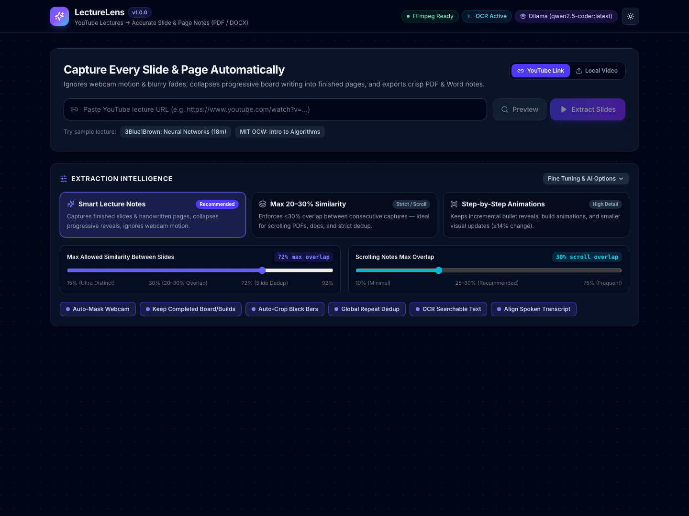
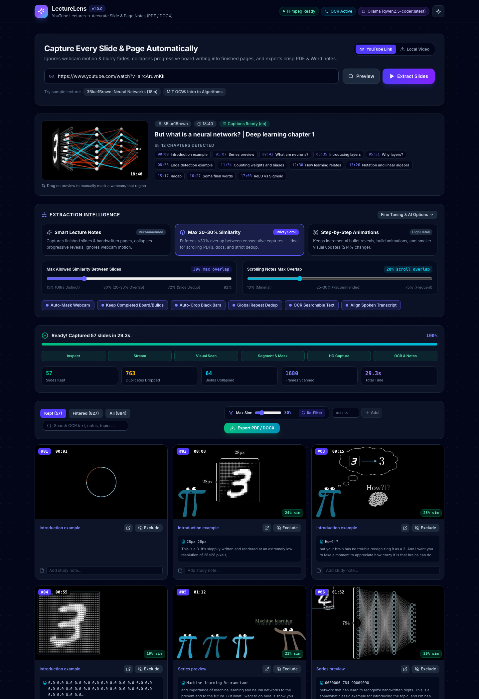
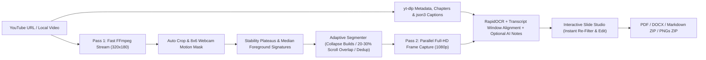

# LectureLens

> **Turn any YouTube lecture (or local lecture video) into crisp, deduplicated slide & page notes in seconds — exported to publication-grade PDF, editable Word (`.docx`), and Obsidian/Notion Markdown.**

[](pyproject.toml)
[](backend/lecturelens/server.py)
[](frontend)
[](https://colab.research.google.com/github/manthansonarkar/LectureLens/blob/main/LectureLens_Colab.ipynb)
[](LICENSE)



---

## Why LectureLens?

Educational lectures on YouTube (MIT OCW, 3Blue1Brown, NPTEL, Gate/JEE prep, coding tutorials) frequently come **without downloadable slides or notes**. Taking manual screenshots interrupts focus, while naive scene-change scripts produce **hundreds of near-duplicate frames** whenever a lecturer waves their hand, moves a cursor, speaks in a webcam PiP box, or fades between slides.

**LectureLens** automates note capture with a fast **two-pass computer vision pipeline** engineered specifically for real lectures:

- **Background-Invariant Foreground & Active-Tile Matching:** Uses local median background isolation and active-tile structural similarity so shared slide themes, watermarks, and dark/light templates do not skew slide-change detection.
- **Automatic Webcam / Speaker Overlay Masking:** Detects continuous corner/edge PiP motion across static slides via `8×6` grid temporal variance so talking-head motion never triggers duplicate screenshots (plus drag-to-mask custom exclusion in the Web UI).
- **Progressive Build & Handwriting Collapse:** Distinguishes *adding bullets or writing new equations onto the same page* (high forward retention `ret_a_to_b`) from *switching to a new slide* — automatically capturing the **completed, crispest frame** right before transition.
- **Scroll-Aware 20–30% Overlap Mode:** When scrolling through PDFs, textbook pages, or code editors, two-stage vertical shift correlation waits until overlap with the previous screenshot drops to your chosen threshold (default **20–30% overlap**) so every screenshot brings ~70–80% brand-new material without missing lines.
- **Fade & Blur Immunity:** Samples only from settled stability plateaus using 75th-percentile tile variance and picks the sharpest frame (Laplacian variance), eliminating blurry cross-dissolve frames.
- **Searchable OCR + Spoken Transcript Alignment:** Runs offline **RapidOCR** across captured slides, matches YouTube captions (`json3`) to each slide's exact screen-time window, and optionally synthesizes bullet takeaways via local **Ollama**, **Gemini**, or **OpenAI**.
- **Publication-Grade Exports:**
  - **PDF** (`Full Study Notes`, `Cornell Ruled Notes`, `2×1 Lecture Handout`, `2×2 Revision Grid`) with clickable YouTube timestamp deep-links (`&t=...s`)
  - **Microsoft Word (`.docx`)** editable study document with embedded high-res slides, hyperlinks, and shaded OCR callout blocks
  - **Markdown + PNGs (`.zip`)** ready for Notion or Obsidian

---

## Live Slide Studio Preview



---

## Architecture



---

## Quick Start

### Prerequisites
- **Python 3.11+**
- **FFmpeg** (`brew install ffmpeg` on macOS, `sudo apt install ffmpeg` on Ubuntu/Debian)
- **Node.js 20+** *(optional — only needed if modifying the React frontend; pre-built static UI is included or built via Vite, and Node also accelerates `yt-dlp` YouTube extraction)*

### 1. Clone & Install

```bash
git clone https://github.com/manthansonarkar/LectureLens.git
cd LectureLens

python3 -m venv .venv
source .venv/bin/activate   # Windows: .venv\Scripts\activate
pip install --upgrade pip
pip install -r requirements.txt
pip install --no-deps -e .
```

*(If modifying the frontend UI: `cd frontend && npm install && npm run build && cd ..`)*

### 2. Launch the Web Studio

```bash
lecturelens serve --open
```

Open **[http://127.0.0.1:8000](http://127.0.0.1:8000)**, paste any YouTube lecture URL (or drop a local `.mp4`/`.mkv`), pick a mode (**Smart Lecture Notes** or **Max 20–30% Similarity**), inspect/search slides, and export your **PDF** or **DOCX**!

---

## CLI Usage

Extract slides headlessly straight from your terminal:

```bash
# Default: Smart Lecture Notes -> exports PDF + DOCX
lecturelens extract "https://www.youtube.com/watch?v=aircAruvnKk" --out ./notes

# Strict 20-30% similarity / scroll overlap mode + Cornell Notes PDF layout
lecturelens extract "https://www.youtube.com/watch?v=VIDEO_ID" \
  --preset strict_overlap \
  --max-similarity 0.28 \
  --scroll-overlap 0.25 \
  --pdf-layout cornell_notes \
  --format pdf --format docx --format markdown_zip

# Local recorded lecture with optional local Ollama AI summary
lecturelens extract ./recorded_lecture.mp4 --ai ollama --ai-model gemma3:4b
```

---

## Google Colab (Cloud Mode — Zero Laptop Storage)

Want to keep video downloads and processing completely off your laptop?

1. Click the **Open in Colab** badge at the top of this page (or open [LectureLens_Colab.ipynb in Google Colab](https://colab.research.google.com/github/manthansonarkar/LectureLens/blob/main/LectureLens_Colab.ipynb)).
2. Run **Step 1** (automatically clones `https://github.com/manthansonarkar/LectureLens.git` and installs dependencies on Google's cloud server).
3. Paste any YouTube URL in **Step 2**, pick your preset (`strict_overlap` for `20–30%` max similarity or `smart`), and run — only the final `.pdf` / `.docx` downloads (or saves directly to Google Drive if `SAVE_TO_GOOGLE_DRIVE` is checked), leaving your MacBook/laptop storage 100% untouched.
4. *(Optional)* Run **Step 3** to launch the full interactive Web Studio inside Colab.

---

## Docker

```bash
docker compose up --build
```

Then visit `http://localhost:8000`.

---

## Development & Testing

Run the automated test suite (synthetic MP4 lectures covering fade transitions, moving webcam PiP, progressive bullet builds, scrolling overlap, PDF/DOCX integrity, and FastAPI endpoints) plus Ruff linting:

```bash
pip install -e ".[dev]"
ruff check backend tests
pytest -v
```

---

## Project Structure

```text
LectureLens/
├── backend/lecturelens/
│   ├── detector.py      # Two-pass FFmpeg scanner, stability plateaus & adaptive segmenter
│   ├── similarity.py    # Median foreground isolation, active-tile SSIM, webcam & scroll masks
│   ├── downloader.py    # Cached yt-dlp stream, chapters & json3 transcript parser
│   ├── ocr.py           # Cross-platform RapidOCR, transcript alignment & optional LLM hook
│   ├── exporter.py      # ReportLab PDF (4 layouts), python-docx Word & Markdown/ZIP exporters
│   ├── server.py        # FastAPI + SSE real-time progress + instant re-filter API
│   └── cli.py           # Typer + Rich CLI
├── frontend/            # React 19 + TypeScript + Tailwind CSS Studio Web UI
├── tests/               # Synthetic video & API test suite
├── Dockerfile
└── pyproject.toml
```

---

## License

MIT License — see [LICENSE](LICENSE).
